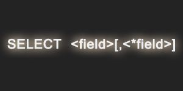
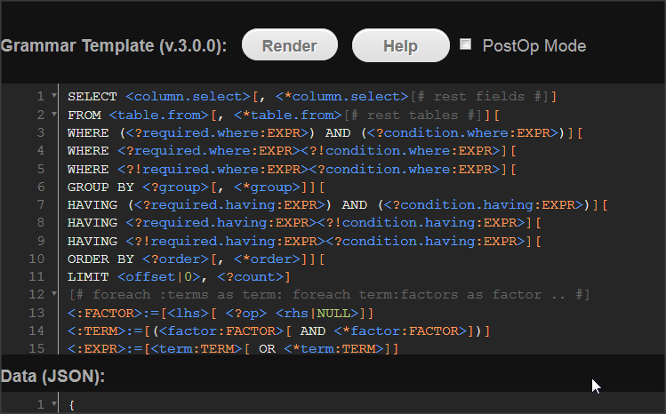

# GrammarTemplate

`GrammarTemplate` versatile and intuitive grammar-based templating for PHP, Python, Browser / Node.js / XPCOM Javascript (see for example [here](https://github.com/foo123/Dialect) and [here](https://github.com/foo123/Xpresion) and [eventualy here](https://github.com/foo123/RhoLambda))





[Etymology of *"grammar"*](http://www.etymonline.com/index.php?term=grammar)
[Etymology of *"template"*](http://www.etymonline.com/index.php?term=template)


**light-weight (~7.7kB minified, ~3.2kB zipped)**

* `GrammarTemplate` is also a `XPCOM JavaScript Component` (Firefox) (e.g to be used in firefox browser addons/plugins)


**version 3.0.0** [GrammarTemplate.js](https://raw.githubusercontent.com/foo123/GrammarTemplate/master/src/js/GrammarTemplate.js), [GrammarTemplate.min.js](https://raw.githubusercontent.com/foo123/GrammarTemplate/master/src/js/GrammarTemplate.min.js)

[Live Playground Example](https://foo123.github.io/examples/grammar-template)

[](https://foo123.github.io/examples/grammar-template)


### API

**Grammar Template**

A block inside `[..]` represents an optional block of `code` (depending on passed parameters) and `<..>` describe placeholders for `query` parameters / variables (i.e `non-terminals`).
The optional block of code depends on whether **all** optional parameters defined inside (with `<?..>`, `<?!..>` or `<*..>` and `<{n,m}..>` for rest parameters) exist. Then, that block (and any nested blocks it might contain) is output, else bypassed.

A block defined with `:=[..]` represents a (recursive) sub-template, which can be used to render any deep/structured argument a needed (see below).


```javascript
var GrammarTemplate = require("../src/js/GrammarTemplate.js"), echo = console.log;

echo('GrammarTemplate.VERSION = ' + GrammarTemplate.VERSION);
echo( );

var tpl = "SELECT <column.select>[, <*column.select>]\nFROM <table.from>[, <*table.from>][\nWHERE (<?required.where>) AND (<?condition.where>)][\nWHERE <?required.where><?!condition.where>][\nWHERE <?!required.where><?condition.where>][\nGROUP BY <?group>[, <*group>]][\nHAVING (<?required.having>) AND (<?condition.having>)][\nHAVING <?required.having><?!condition.having>][\nHAVING <?!required.having><?condition.having>][\nORDER BY <?order>[, <*order>]][\nLIMIT <offset|0>, <?count>]";

var sql = new GrammarTemplate( tpl );

echo("input template:");
echo(tpl);

echo( );

echo("output:");
echo(sql.render({
    column      : { select : [ 'field1', 'field2', 'field3', 'field4' ] },
    table       : { from : [ 'tbl1', 'tbl2' ] },
    condition   : { where : 'field1=1 AND field2=2', having : 'field3=1 OR field4=2' },
    count       : 5
}));
```

**output**
```text
GrammarTemplate.VERSION = 3.0.0

input template:
SELECT <column.select>[, <*column.select>]
FROM <table.from>[, <*table.from>][
WHERE (<?required.where>) AND (<?condition.where>)][
WHERE <?required.where><?!condition.where>][
WHERE <?!required.where><?condition.where>][
GROUP BY <?group>[, <*group>]][
HAVING (<?required.having>) AND (<?condition.having>)][
HAVING <?required.having><?!condition.having>][
HAVING <?!required.having><?condition.having>][
ORDER BY <?order>[, <*order>]][
LIMIT <offset|0>, <?count>]

output:
SELECT field1, field2, field3, field4
FROM tbl1, tbl2
WHERE field1=1 AND field2=2
HAVING field3=1 OR field4=2
LIMIT 0, 5
```

```javascript
var GrammarTemplate = require("../src/js/GrammarTemplate.js"), echo = console.log;

echo('GrammarTemplate.VERSION = ' + GrammarTemplate.VERSION);
echo( );

/*
    i.e: 
    foreach "expression:terms" as "term":
        foreach "term:factors" as "factor":
            ..
    
    here an :EXPR template is defined which itself uses (anonymous) sub-templates
    it is equivalent to (expand sub-templates to distinct):

<:FACTOR>:=[<lhs>[ <?op> <rhs|NULL>]]

<:TERM>:=[(<factor:FACTOR>[ AND <*factor:FACTOR>])]

<:EXPR>:=[<term:TERM>[ OR <*term:TERM>]]

<expression:EXPR>
<expression2:EXPR>

*/

var tpl = "<:EXPR>:=[<term>:=[(<factor>:=[<lhs>[ <?op> <rhs|NULL>]][ AND <*factor>])][ OR <*term>]]<expression:EXPR>\n<expression2:EXPR>";

var expr = new GrammarTemplate( tpl );

echo("input template:");
echo(tpl);

echo( );

echo("output:");
echo(expr.render({
    expression  : [
        // term
        [
            // factor
            {lhs: 1, op: '=', rhs: 1},
            // factor
            {lhs: 1, op: '=', rhs: 2},
            // factor
            {lhs: 1, op: '=', rhs: 3}
        ],
        // term
        [
            // factor
            {lhs: 1, op: '<', rhs: 1},
            // factor
            {lhs: 1, op: '<', rhs: 2},
            // factor
            {lhs: 1, op: '<', rhs: 3}
        ],
        // term
        [
            // factor
            {lhs: 1, op: '>', rhs: 1},
            // factor
            {lhs: 1, op: '>', rhs: 2},
            // factor
            {lhs: 1, op: '>', rhs: 3}
        ]
    ],
    expression2  : [
        // term
        [
            // factor
            {lhs: 2, op: '=', rhs: 1},
            // factor
            {lhs: 2, op: '=', rhs: 2},
            // factor
            {lhs: 2, op: '=', rhs: 3}
        ],
        // term
        [
            // factor
            {lhs: 2, op: '<', rhs: 1},
            // factor
            {lhs: 2, op: '<', rhs: 2},
            // factor
            {lhs: 2, op: '<', rhs: 3}
        ],
        // term
        [
            // factor
            {lhs: 2, op: '>', rhs: 1},
            // factor
            {lhs: 2, op: '>', rhs: 2},
            // factor
            {lhs: 2, op: '>', rhs: 3}
        ],
        // term
        [
            // factor
            {lhs: 3},
            // factor
            {lhs: 3, op: '!='}
        ]
    ]
}));
```
**output**
```text
GrammarTemplate.VERSION = 3.0.0

input template:
<:EXPR>:=[<term>:=[(<factor>:=[<globalNegation:NEG><lhs>[ <?op:OP> <rhs|NULL>]][ AND <*factor>])][ OR <*term>]]<expression:EXPR>
<expression2:EXPR>

output:
(NOT 1 = 1 AND NOT 1 = 2 AND NOT 1 = 3) OR (NOT 1 < 1 AND NOT 1 < 2 AND NOT 1 < 3) OR (NOT 1 > 1 AND NOT 1 > 2 AND NOT 1 > 3)
(NOT 2 = 1 AND NOT 2 = 2 AND NOT 2 = 3) OR (NOT 2 < 1 AND NOT 2 < 2 AND NOT 2 < 3) OR (NOT 2 > 1 AND NOT 2 > 2 AND NOT 2 > 3) OR (NOT 3 AND NOT 3 <> NULL)
```

```javascript
var GrammarTemplate = require("../src/js/GrammarTemplate.js"), echo = console.log;

echo('GrammarTemplate.VERSION = ' + GrammarTemplate.VERSION);
echo( );

var tpl = "<:BLOCK>:=[BLOCK <.name>\n{\n[    <@.blocks:BLOCKS>?\n]}]<:BLOCKS>:=[<@block:BLOCK>[\n<@block:BLOCK>*]]<@blocks:BLOCKS>";

var aligned = new GrammarTemplate( tpl, null, true );

echo("input template:");
echo(tpl);

echo( );

echo("output:");
echo(aligned.render({
    blocks      : [
    {
        name        : "block1",
        blocks      : null
    },
    {
        name        : "block2",
        blocks      : [
            {
                name   : "block21",
                blocks : [
                    {
                        name   : "block211",
                        blocks : [
                            {
                                name   : "block2111",
                                blocks : null
                            },
                            {
                                name   : "block2112"
                            }
                        ]
                    },
                    {
                        name   : "block212"
                    }
                ]
            },
            {
                name   : "block22",
                blocks : [
                    {
                        name   : "block221"
                    },
                    {
                        name   : "block222"
                    }
                ]
            }
        ]
    },
    {
        name        : "block3"
    }
]
}));
```


```text
GrammarTemplate.VERSION = 3.0.0

input template:
<:BLOCK>:=[BLOCK <.name>
{
[    <@.blocks:BLOCKS>?
]}]<:BLOCKS>:=[<@block:BLOCK>[
<@block:BLOCK>*]]<@blocks:BLOCKS>

output:
BLOCK block1
{
}
BLOCK block2
{
    BLOCK block21
    {
        BLOCK block211
        {
            BLOCK block2111
            {
            }
            BLOCK block2112
            {
            }
        }
        BLOCK block212
        {
        }
    }
    BLOCK block22
    {
        BLOCK block221
        {
        }
        BLOCK block222
        {
        }
    }
}
BLOCK block3
{
}
```

### TODO

* handle literal symbols (so for example grammar-specific delimiters can also be used literaly, right now delimiters can be adjusted as parameters) [DONE, through escaping]
* handle nested/deep arguments [DONE, through nested object-dot notation]
* handle recursion/loop deep structured arguments and sub-templates [DONE, through defining recursive sub-templates for rendering any deep argument]
* handle boolean-like optional arguments [DONE, through setting (empty) default value for optional argumement, is handled as pure boolean on/off flag argument]
* optimise parsing and rendering [DONE]
* support some basic and/or user-defined functions [DONE, similar custom function definition as custom sub-template, calls function if custom function with same name has been defined]
* support both `pre-` and `post-` (repeat) grammar operators, i.e both `<?symbol>`,`<*symbol>`,`<{n,m}symbol>` and `<symbol>?`,`<symbol>*`,`<symbol>{n,m}` for more familiar grammar syntax [DONE, via extra parameter in template instantiation]
* support comments [DONE, through comment block notation, i.e `[# comment here #]`]
* handle generic/dynamic unknown before-hand custom rendering methods [DONE, can attach to generic wildcard renderer `*` and handle/dispatch based on passed template name]
* handle same name local and global arguments in (deep) recursive templates, avoiding possible global conflicts and infinite loops [DONE, through explicit local dot `.` argument notation]
* handle explicit text/code alignment/indentation expansion in sequence [DONE, use aligned `@` argument notation]
* handle custom delimiters with different lengths and possibly same prefixes [DONE, by dynamicaly arranging parsing by delimiter string length]

**see also:**

* [Abacus](https://github.com/foo123/Abacus) Computer Algebra and Symbolic Computation System for Combinatorics and Algebraic Number Theory for JavaScript
* [SciLite](https://github.com/foo123/SciLite) Scientific Computing Environment similar to Octave/Matlab/SciPy in pure JavaScript
* [TensorView](https://github.com/foo123/TensorView) view array data as multidimensional tensors of various shapes efficiently
* [FILTER.js](https://github.com/foo123/FILTER.js) Video and Image Processing and Computer Vision Library similar to OpenCV in pure JavaScript (browser and nodejs)
* [HAAR.js](https://github.com/foo123/HAAR.js) image feature detection based on Haar Cascades in JavaScript (Viola-Jones-Lienhart et al Algorithm)
* [HAARPHP](https://github.com/foo123/HAARPHP) image feature detection based on Haar Cascades in PHP (Viola-Jones-Lienhart et al Algorithm)
* [MOD3](https://github.com/foo123/MOD3) 3D Modifier Library in JavaScript
* [Geometrize](https://github.com/foo123/Geometrize) Computational Geometry and Rendering Library for JavaScript
* [Fuzzion](https://github.com/foo123/Fuzzion) a library of fuzzy / approximate string metrics for PHP, JavaScript, Python
* [Matchy](https://github.com/foo123/Matchy) a library of string matching algorithms for PHP, JavaScript, Python
* [Regex Analyzer/Composer](https://github.com/foo123/RegexAnalyzer) Regular Expression Analyzer and Composer for PHP, JavaScript, Python
* [PatternMatchingAlgorithms](https://github.com/foo123/PatternMatchingAlgorithms) library of Pattern Matching Algorithms in JavaScript using [Matchy](https://github.com/foo123/Matchy)
* [SortingAlgorithms](https://github.com/foo123/SortingAlgorithms) library of Sorting Algorithms in JavaScript
* [Xpresion](https://github.com/foo123/Xpresion) a simple and flexible eXpression parser engine (with custom functions and variables support), based on [GrammarTemplate](https://github.com/foo123/GrammarTemplate), for PHP, JavaScript, Python
* [GrammarTemplate](https://github.com/foo123/GrammarTemplate) grammar-based templating for PHP, JavaScript, Python
* [codemirror-grammar](https://github.com/foo123/codemirror-grammar) transform a formal grammar in JSON format into a syntax-highlight parser for CodeMirror editor
* [ace-grammar](https://github.com/foo123/ace-grammar) transform a formal grammar in JSON format into a syntax-highlight parser for ACE editor
* [prism-grammar](https://github.com/foo123/prism-grammar) transform a formal grammar in JSON format into a syntax-highlighter for Prism code highlighter
* [highlightjs-grammar](https://github.com/foo123/highlightjs-grammar) transform a formal grammar in JSON format into a syntax-highlight mode for Highlight.js code highlighter
* [syntaxhighlighter-grammar](https://github.com/foo123/syntaxhighlighter-grammar) transform a formal grammar in JSON format to a highlight brush for SyntaxHighlighter code highlighter
